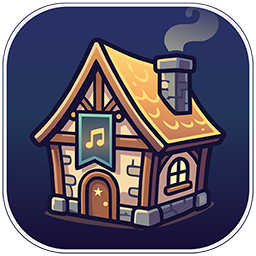

<div align="center">



# VenueMapper

**Your FFXIV venue guide, right inside the game.**

Find housing venues, see who is open right now, follow a line to the bar, the stage or the DJ,<br>
and add your own venue or festival without leaving the game.

[](https://github.com/SunnysTTV/VenueMapperXIV/releases)
[](https://github.com/SunnysTTV/VenueMapperXIV/releases)
[](https://github.com/SunnysTTV/VenueMapperXIV/releases)
[](https://github.com/goatcorp/Dalamud)
[](#license)

[](https://venuemapper.sunexa.xyz)
[](https://ko-fi.com/sunnysofficial)
[](https://crowdin.com/project/venuemapper)


[Installation](#installation) · [Features](#features) · [Commands](#commands) · [For owners](#for-venue-owners) · [Privacy](#privacy)

</div>

---

## Highlights

<table>
<tr>
<td width="33%" valign="top">

**What is open now**<br>
Live status for every venue, the next event, and quick filters for Open now, Open today and your favorites.

</td>
<td width="33%" valign="top">

**Find your way inside**<br>
The game's own floor maps with service pins, automatic floor detection and a line on the floor that leads you there.

</td>
<td width="33%" valign="top">

**Right in the world**<br>
Venue pins above houses, names on the house placards, 3D markers at the bar, stage and DJ.

</td>
</tr>
<tr>
<td valign="top">

**Festivals**<br>
Multi-day festivals across several houses, a festival map with stalls, and a teleport straight there.

</td>
<td valign="top">

**Passport**<br>
A stamp for every venue you visit while it is open, plus badges. Stored only on your PC.

</td>
<td valign="top">

**For owners**<br>
Submit or update your venue in game, with services captured from where you stand.

</td>
</tr>
</table>

## Installation

1. Open Dalamud Settings with `/xlsettings`
2. Go to the **Experimental** tab
3. Add this custom repository URL:
   ```
   https://raw.githubusercontent.com/SunnysTTV/sunnysrepo/main/pluginmaster.json
   ```
4. Save, then search for **Venue Mapper** in the Plugin Installer

> [!TIP]
> Install [Lifestream](https://github.com/NightmareXIV/Lifestream) as well to teleport to venues and festivals with one click.

## Features

<details open>
<summary><b>Find venues</b></summary>

- **Venue directory** with search, data center and server filters, favorites and hidden venues
- **Live status**: who is open now, who opens soon, and each venue's next event
- **Overview and quick filters**: Open now, Favorites, Open today, My data center
- **Venue details** with banner, logo, address, services per floor, next event and links
- **One-click Teleport** through Lifestream, click again to cancel
- **Show on map** puts a flag on the venue's plot
- **Share a venue** as chat text, for Discord with links, as a web link, as a Lifestream command or as a map flag
- **Clickable venues in chat**: venue names, addresses and VenueMapper website links in chat become links (channels are up to you)
- **Party Finder ads**: venues you saw advertised in the Party Finder get a megaphone, click it to open the ad again

</details>

<details>
<summary><b>Maps and finding your way</b></summary>

- **Interactive map** with the game's own floor maps, service pins, zoom and pan
- **Automatic floor detection**, including the venue's garden
- **Ward view**: every venue in your ward as a pin on the ward map
- **Floor guide**: click a service and a line on the floor points you there, over the stairs if needed
- **Venues on the game map**: venue icons and names on the game's own map and minimap

</details>

<details>
<summary><b>3D in the world</b></summary>

- **3D markers** at every service spot: an icon badge, a name bubble when you are close, a soft floor glow
- **Venues above houses**: in housing wards every venue gets a pin above its house with its initials, name, opening time and distance, a little bigger the farther away you are
- **Garden markers** as soon as you step onto the venue's plot
- **Names on house placards**: the placard in front of a venue shows its name and when it opens next

</details>

<details>
<summary><b>Festivals</b></summary>

- **Festivals tab** with live and upcoming festivals, multi-day schedules and several houses
- **Teleport to festivals** in a ward or anywhere in the open world, with a map flag on the area
- **At the festival**: welcome message, festival map with stalls, 3D markers for stalls and stages

</details>

<details>
<summary><b>Notifications</b></summary>

- **Welcome banners** when you arrive at a venue or festival
- **Favorite opened** alerts and **event and festival reminders** (5 to 60 minutes before)
- **House rules** card when you enter a venue that has rules
- Notification corner, duration, combat pause and a full **notification history**

</details>

<details>
<summary><b>Passport and secrets</b></summary>

- **Venue passport**: a stamp for every venue you visit while it is open, plus badges. Stored only on your PC, per character
- A handful of hidden easter eggs

</details>

<details>
<summary><b>For owners and organizers</b></summary>

- **Submit your venue** with services captured from your own position, links, colors, banner and house rules
- **Update your venue** after an Owner ID check, with everything prefilled
- **Submit a festival** with days, houses and stalls, and preview it in game before you send it

</details>

<details>
<summary><b>Comfort</b></summary>

- English and German interface
- Accessibility options: marker size, strong pulse, custom marker color
- Venue list updates from GitHub at start and every hour (can be turned off)

</details>

## Commands

| Command | What it does |
|---|---|
| `/vmapper` | Open or close the main window (map when you are at a venue, otherwise the directory) |
| `/vmapper venues` | Open the directory |
| `/vmapper map` | Open the map |
| `/vmapper events` | Open the events |
| `/vmapper festivals` | Open the festivals |
| `/vmapper settings` | Open the settings |
| `/vmapper owner` | Submit your venue |
| `/vmapper festival` | Submit a festival |
| `/vmapper quick` | Show or hide the quick popup at a venue |
| `/vmapper pull` | Download the newest venue list now |
| `/vmapper markers [on\|off]` | Turn 3D markers on or off |

## For venue owners

1. Run `/vmapper owner`
2. Fill in your venue: name, address, colors, links and an optional banner
3. Stand on each spot and press **Use my pos** to add bars, stages, DJ booths and more, on every floor and in the garden
4. Add a few house rules if you like, in English and optionally in German
5. Send it with the prefilled Google Form, or copy the JSON for our Discord

Your venue shows up after review. Already listed? Use **Update Venue** in the About tab. It checks your Owner ID and prefills everything, so you only change what is new.

More help for owners on the [website](https://venuemapper.sunexa.xyz/owners).

## For festival organizers

Run `/vmapper festival`, add the place and the days, add your stalls, preview the festival in game and send the JSON to our Discord.

## Privacy

- No accounts, no tracking, no telemetry
- The venue list comes from this repository, opening times and banners from [FFXIVVenues](https://ffxivvenues.com), events and logos from [Partake](https://www.partake.gg). None of these requests contain your name, world, position or character ID
- Your passport, favorites and settings stay on your PC
- Party Finder ads are only read from what your game already shows you, nothing is sent anywhere
- The venue form only sends what you type in. Your character ID is only included if you choose to register as owner, and only as a salted hash

## Translate

English and German are available today. Want VenueMapper in your language? Help on [Crowdin](https://crowdin.com/project/venuemapper).

## Built with

- [Dalamud](https://github.com/goatcorp/Dalamud), [Lumina](https://github.com/NotAdam/Lumina) and [FFXIVClientStructs](https://github.com/aers/FFXIVClientStructs)
- [Pictomancy](https://github.com/sourpuh/ffxiv_pictomancy) for everything 3D
- [Lifestream](https://github.com/NightmareXIV/Lifestream) for teleports
- [Partake](https://www.partake.gg) and [FFXIVVenues](https://ffxivvenues.com) for events, schedules and banners

## Artwork

- Plugin logo by Hultay

## Links

- [Website](https://venuemapper.sunexa.xyz)
- [Support on Ko-fi](https://ko-fi.com/sunnysofficial)
- [Report an issue](https://github.com/SunnysTTV/VenueMapperXIV/issues)
- [More projects on sunexa.xyz](https://sunexa.xyz)

## License

MIT
